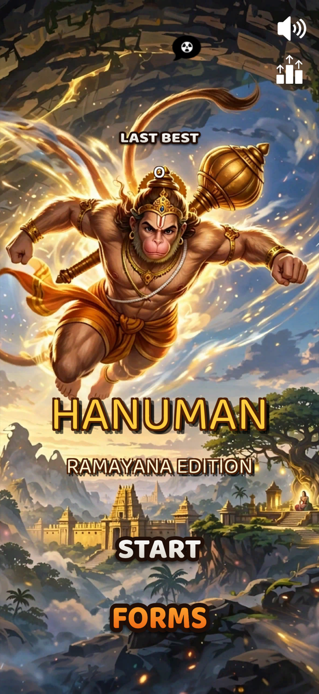
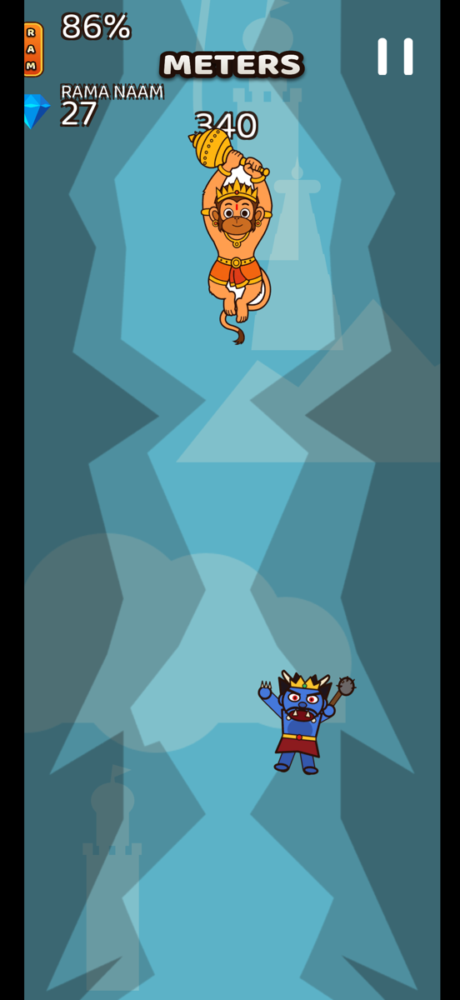
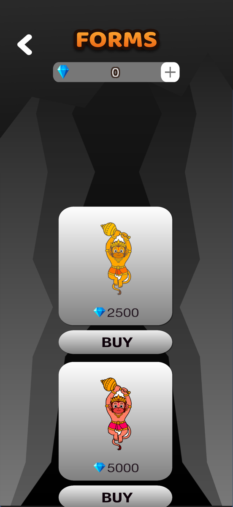
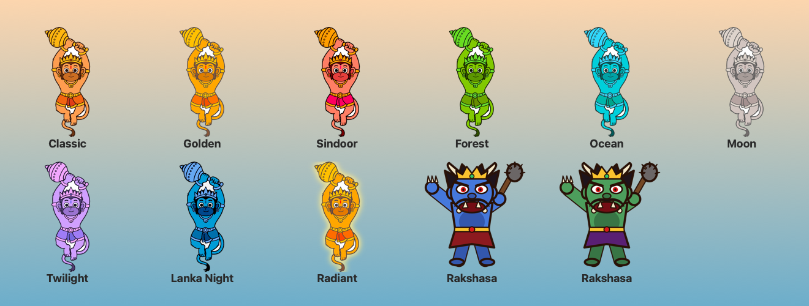

# Hanuman: Ramayana Edition

A devotional endless-faller for iOS and Android, built in Unity. Hanuman leaps across the ocean toward Lanka to find Sita, dodging spikes, Surasa's jaws, Simhika's shadow and Ravana's rakshasas, and chanting his way forward on **Rama Naam** energy.

  
  &nbsp;&nbsp;
  
  &nbsp;&nbsp;
  

> Work in progress. This game is a fork of [Hyper Dive](https://github.com/Prajwalvv/Hyper-Dive) by **Prajwalvv**, re-themed around the Ramayana. Full credit for the original game goes to him (see [Credits](#credits)).

## The journey

| Chapter | Distance | Story beat |
|---|---|---|
| Kishkindha | 0 m | Hanuman takes Rama's ring |
| The Great Leap | 150 m | Across the ocean to Lanka |
| Lanka | 400 m | The golden city of Ravana |
| Ashoka Vatika | 700 m | The search for Sita |
| Rakshasa Battle | 1000 m | Hanuman faces Ravana's warriors |
| Lanka Burns | 1400 m | Fire sweeps through the city |
| Sanjeevani | 1800 m | The mountain of healing herbs |
| Victory | 2300 m | Jai Shri Ram |

## What's in the game

- **Rama Naam energy.** It slowly drains as you fall. Collect saffron **RAM** tablets to refill it; when it hits zero the run ends.
- **The Great Leap hazards.**
  - Surasa's Jaws: a wall with a narrow gap to slip through.
  - Simhika's Shadow: an orb that chases you.
  - Ocean rocks.
  - Mainaka Peak: a golden pickup that restores energy.
- **Rakshasas.** Ravana's demon warriors weave upward toward Hanuman from about 12 seconds into every run.
- **The original obstacles** are still here: spiked mines, saw blades and canyon walls. The mines hold off for the first 8 seconds.
- **Eight Hanuman forms** to unlock with gems in the **FORMS** shop.
- **Ramayana scenery.** A dawn-to-dusk sky with temple gopurams, Lanka towers, palms, lotuses and mountains drifting past.
- **Original music.** A serene Raag Yaman bansuri over a tanpura drone, as a seamless 73-second loop.
- **Fits any phone.** It draws edge to edge, and the HUD keeps clear of notches, the Dynamic Island and the home bar.

## Controls

| Where | How |
|---|---|
| Phone | Drag left or right to steer Hanuman |
| Unity editor | Drag with the mouse, or use the ← → arrow keys (A / D) |

## Open the project

1. Install **Unity 2022.3.62f3** via Unity Hub. On Apple Silicon Macs, install Rosetta 2 too (`softwareupdate --install-rosetta`), because Unity's package manager needs it.
2. In Unity Hub, choose **Add → Add project from disk** and select the **`hyper dive`** folder inside this repo.
3. Open `Assets/Scenes/start.unity` for the menu, or `SampleScene.unity` to jump straight into a run.
4. To see it as a phone, switch the Game view to **Simulator** and pick **Modern iPhone 6.3in (Dynamic Island)**. That profile lives in `Assets/DeviceSimulator/`.

Ads and in-app purchases are switched off for now. Their plugins are parked in `hyper dive/_disabled_monetization/`, and the scripts compile as stubs unless you add the `HD_ADS` / `HD_IAP` scripting defines.

## Where things live

| Area | Files |
|---|---|
| Chapters and distance | `scripts/chapterManager.cs` |
| Ramayana hazards (Surasa, Simhika, rocks, Mainaka) | `scripts/ramayanaObstacleSet.cs` |
| Rakshasas | `scripts/ramayanaDemons.cs` |
| Drifting scenery | `scripts/ramayanaBackdrop.cs` |
| Hanuman, steering, Rama Naam energy | `scripts/move.cs` |
| Safe-area handling for notches | `scripts/safeAreaFitter.cs` |
| Setup notes and status | [`RAMAYANA_SETUP.md`](RAMAYANA_SETUP.md) |

All paths are under `hyper dive/Assets/`. Everything in the game objects lives on the **RamayanaDirector** object in `SampleScene`, where damage, speed and timing can be tuned in the Inspector.

### Regenerating art and music

These scripts are in `tools/` and run on macOS:

| Script | Makes |
|---|---|
| `swift tools/render_ui_text.swift` | All button and label images in Baloo 2, plus the RAM badge |
| `swift tools/make_hanuman_forms.swift` | The eight Hanuman forms |
| `swift tools/make_ramayana_sprites.swift` | Rakshasas and scenery silhouettes |
| `python3 tools/make_ramayana_music.py` | The Raag Yaman theme loop |

## Before publishing

- [ ] Get Prajwalvv's permission to publish a game based on Hyper Dive, and credit him in the app and the store listing.
- [ ] Confirm the Muse-generated artwork (menu background and Hanuman) may be used commercially.
- [ ] Set your own bundle ID, company name and app name (Player Settings).
- [ ] Re-enable current ad and IAP SDKs with your own IDs.

## Credits

- **Original game:** [Hyper Dive](https://github.com/Prajwalvv/Hyper-Dive) by Prajwalvv: gameplay, levels, obstacles, shop and UI.
- **Ramayana edition:** [girishmohan](https://github.com/girishmohan).
- **Hanuman and menu art:** generated with Muse.
- **Font:** [Baloo 2](https://github.com/EkType/Baloo2) by Ek Type, SIL Open Font License 1.1 (`hyper dive/Assets/A-Z_Materials/fonts/Baloo2/OFL.txt`).
- **Music, rakshasas, scenery and UI text art:** original, generated by the scripts in `tools/`.

## License

The original Hyper Dive README states an MIT License, but its repository has no LICENSE file. Please check with the original author before reusing or publishing this code.
